<h1 align="center">Etienne</h1>

<b>Ich vermesse Märkte und baue die Werkzeuge dazu.</b> 
475 GB geprüfte Marktdaten, 31 Instrumente in 5-Minuten-Auflösung, 16 Jahre Historie — ein Research-Stack von der Datenhaltung bis zum Live-Bot. 

<picture><source media="(prefers-color-scheme: dark)" srcset="./assets/stats-dark.svg"/><source media="(prefers-color-scheme: light)" srcset="./assets/stats-light.svg"/></picture>

## Der Datenbestand

Alles fängt bei den Daten an. Wer ihnen glaubt, statt sie zu prüfen, backtestet sein eigenes Wunschdenken. Deshalb steht am Anfang ein Katalog: jeder Ordner erfasst, jede Preis-Tape benotet.

<picture><source media="(prefers-color-scheme: dark)" srcset="./assets/city-dark.svg"/><source media="(prefers-color-scheme: light)" srcset="./assets/city-light.svg"/></picture>

<picture><source media="(prefers-color-scheme: dark)" srcset="./assets/quality-dark.svg"/><source media="(prefers-color-scheme: light)" srcset="./assets/quality-light.svg"/></picture>

**63 von 84 Tapes tragen Note A**, 17 Note B, 4 Note C. Ein markiertes Feld heisst nicht kaputt — es heisst geprüft und gekennzeichnet, damit der Backtest die Stelle kennt, statt über sie zu stolpern.

<picture><source media="(prefers-color-scheme: dark)" srcset="./assets/planet-dark.svg"/><source media="(prefers-color-scheme: light)" srcset="./assets/planet-light.svg"/></picture>

## Wie gehandelt wird

<picture><source media="(prefers-color-scheme: dark)" srcset="./assets/profile-dark.svg"/><source media="(prefers-color-scheme: light)" srcset="./assets/profile-light.svg"/></picture>

## Worauf es ankommt

Die Reihenfolge, in der ich selbst arbeite, mit dem Grund daneben — nicht nach Sternen sortiert, sondern danach, was das nächste Stück trägt.

| Rang | Baustein | Warum er zählt |

| --- | --- | --- |

| 1 | Datenlager | 475 GB über 866.064 Dateien, dedupliziert, zeitzonenrein, nach zwölf Prüfungen benotet. Jede Zahl weiter unten hängt daran. |

| 2 | Backtest-Engine | Kosten zum echten Venue-Preis, Paritäts-Gate gegen den Live-Bot. Ohne das ist ein Sharpe eine Meinung. |

| 3 | Paper-Strecken | Jede Strategie läuft erst Monate papieren, bevor Geld fliesst. Urteil nach fester Trade-Zahl, nicht nach Gefühl. |

| 4 | Desktop-Apps | Telo, NNT, Multicharts — die Oberflächen, über die der Research bedienbar wird. |

## Nach Zahlen

<picture><source media="(prefers-color-scheme: dark)" srcset="./assets/calendar-dark.svg"/><source media="(prefers-color-scheme: light)" srcset="./assets/calendar-light.svg"/></picture>

<picture><source media="(prefers-color-scheme: dark)" srcset="./assets/curve-dark.svg"/><source media="(prefers-color-scheme: light)" srcset="./assets/curve-light.svg"/></picture>

## Hier anfangen

- [multicharts-releases](https://github.com/Etienne13435/multicharts-releases) — Multicharts desktop — public auto-update feed (installers + latest.json). Source is private.
- [nnt-releases](https://github.com/Etienne13435/nnt-releases) — NNT release binaries. The app auto-checks this repo's latest release for updates (see NNT_UPDATE_REPO).
- [telo-releases](https://github.com/Etienne13435/telo-releases) — Telo release downloads & auto-update feed. Source code lives in a private repository.

Der Research-Code liegt privat. Öffentlich sind die Auto-Update-Feeds der Desktop-Apps, die daraus entstehen.

## Themen

Auktionsmarkt-Theorie und Orderflow

- Market Profile, Value Area, Initial Balance, Volumen am Preis.
- Orderflow an CME NQ und Krypto-Perps, diskretionär und als Algo.

Datenhaltung

- 475 GB in 65 Ordnern, ein Katalog hält sie fest.
- Zwölf Prüfungen je Tape: fehlende Bars, Zeitstempel, OHLC, eingefrorene Kurse, Quellen-Abweichung.
- Archive bis 860 Symbole tief — Funding, Open Interest, Taker-Ratio.

Vom Research in den Live-Betrieb

- Backtest-Engine mit Paritäts-Gate gegen den Live-Bot.
- Paper-Strecken auf eigenem Server, Urteil nach fester Trade-Zahl.
- Holdout wird vor dem Lauf festgeschrieben und danach nicht neu verhandelt.

## Wie diese Seite entsteht

Jede Grafik ist ein selbst gerendertes SVG, zweimal — einmal hell, einmal dunkel — und wird über `prefers-color-scheme` umgeschaltet. Animiert wird mit SMIL und CSS, weil GitHub kein JavaScript in SVG ausführt. Die Zahlen kommen aus [`data/snapshot.json`](./data/snapshot.json); `tools/collect.py` schreibt ihn aus dem privaten Research-Repo, `tools/render.py` zeichnet nur noch daraus. Maschinenlesbar: [AGENTS.md](./AGENTS.md) und [llms.txt](./llms.txt).

Grafiken aus dem eigenen Datenkatalog gerendert (Stand 2026-10-09): 475 GB, 866.064 Dateien, 84 benotete Tapes.

